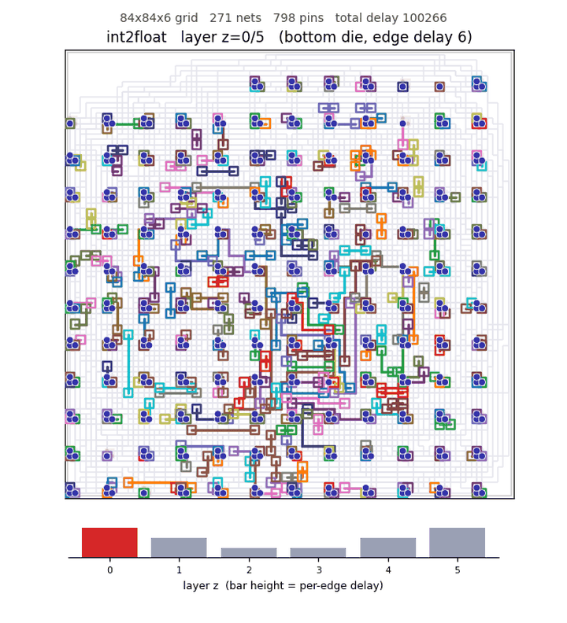
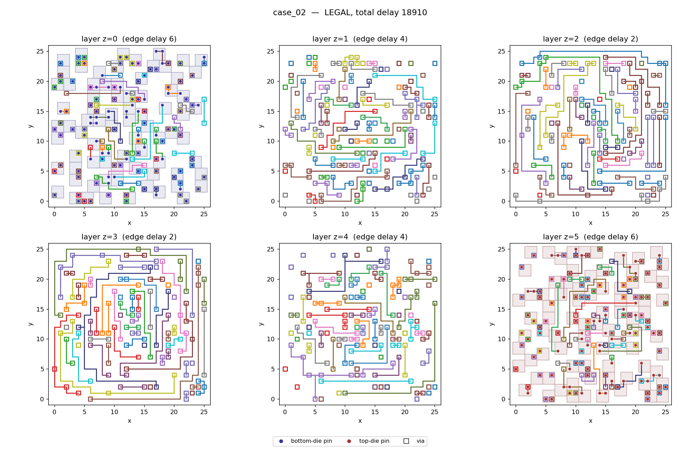
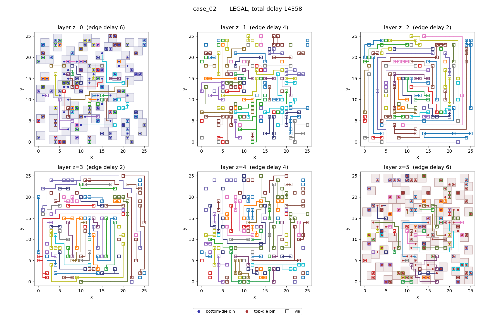

<h1 align="center">azroute</h1>

<p align="center">
  <b>A learned router for 3D integrated circuits</b><br>
  <sub>Search-guided rip-up-and-reroute with a 10 M-parameter network, trained AlphaZero-style on its own search</sub>
</p>

<p align="center">
  
</p>
<p align="center">
  <sub><code>designs/int2float</code>: 271 nets, 798 pins, 84 × 84 × 6 grid, stepping through the six routing layers.<br>
  Total delay 100,266 against the baseline's 152,284 (<b>−34 %</b>).</sub>
</p>

---

## The problem

The [M3D routing challenge](https://github.com/partcleda/eda-3d-routing-challenge) is detailed
routing for a two-die stack. The grid has six metal layers: the outer layers are slow, the middle
ones fast, and vias connect them. Every net must connect its driver to all of its sinks, and no
two nets may share a grid vertex. The objective is total signal delay.

Each case is scored as `baseline delay / our delay` (an illegal routing scores 0). The baseline
is the toolkit's own negotiated-congestion router. The cases range from small boards to a
530 × 530 stress case, plus three placed netlists from real logic designs (`ctrl`, `int2float`,
`router`).

## Results

Every one of the 45 benchmark cases is routed legally, and every routing is accepted by the
challenge's independent checker.

<table align="center">
<tr><th>tier</th><th>cases</th><th>what it tests</th><th>score</th></tr>
<tr><td>intro</td><td align="right">20</td><td>small boards</td><td align="right"><b>1.127</b></td></tr>
<tr><td>hard</td><td align="right">9</td><td>dense boards, little slack</td><td align="right"><b>1.248</b></td></tr>
<tr><td>scale</td><td align="right">8</td><td>large grids</td><td align="right"><b>1.104</b></td></tr>
<tr><td>congested</td><td align="right">4</td><td>more demand than easy capacity</td><td align="right"><b>1.212</b></td></tr>
<tr><td>designs</td><td align="right">3</td><td>netlists from real logic designs</td><td align="right"><b>1.315</b></td></tr>
<tr><td>stress</td><td align="right">1</td><td>530 × 530 grid</td><td align="right"><b>1.071</b></td></tr>
</table>

<p align="center"><sub>Score: the leaderboard's per-tier aggregate, the geometric mean over cases of baseline delay / our delay.
Up to 20 minutes per case on a Colab G4 (AMD EPYC 9B45 with 44 threads in use, NVIDIA RTX PRO 6000 Blackwell).</sub></p>

<table>
<tr><th>Baseline (negotiated congestion): total delay 18,910</th><th>azroute: total delay 14,358 (−24 %)</th></tr>
<tr>
<td></td>
<td></td>
</tr>
</table>
<p align="center"><sub><code>hard/case_02</code>, all six layers: 68 nets on a 26 × 26 × 6 grid.</sub></p>

---

## Architecture

<!-- architecture diagram -->

azroute never builds a routing from scratch with the network. It starts from a legal routing and
improves it one neighbourhood at a time, so **the routing is legal at every moment of the run**.
The network's job is to decide *how* to reroute each neighbourhood, and the search keeps it honest.

### 1. A C++ routing core

Everything that touches the grid lives in a single pybind11 module
([`core/router_core.cpp`](core/router_core.cpp)). It handles vertex ownership, A* Steiner-tree
building with per-mode costs, rip-up, and a checkpoint/rollback journal. The rollback is what
makes search affordable: the search can try a sequence of reroutes and undo them in place
without copying the board.

```python
cp = r.checkpoint()        # journal position
...                        # rip up nets, route them, evaluate
r.rollback(cp)             # undo everything since cp, exactly
r.commit()                 # or make it permanent
```

The initial routing is negotiated congestion (PathFinder-style) with delay-aware trees. It runs
over a few net orders and pressure schedules and keeps the best legal result. That result is
the legal starting point everything else improves on.

### 2. Large-neighbourhood search

The improvement loop ([`routing/lns.py`](routing/lns.py)) picks a badly detoured net, weighted
by its excess over its ideal delay. It then collects the nets blocking that net's ideal tree, and
the nets blocking those, which makes a neighbourhood of 3 to 16 nets. These are ripped up and
rerouted inside a bounded region. The acceptance rule is the invariant that the rest of the
system relies on:

```python
new = st.rerouted_delay
after = self.total + new - st.old_delay
if self.accept.ok(self.total, after, self.best_total):   # default: after <= before
    ...
    r.commit()
    self.log.append({"nets": hood.nets, "region": list(hood.region),
                     "decisions": [[n, m] for n, m in st.done], "prices": st.prices})
    ...
r.rollback(cp)
```

Every accepted reroute is logged together with any network output it used. As a result, each
final routing can be replayed bit-for-bit from the initial routing, and the tests check this.

### 3. Routing decisions

A neighbourhood is rerouted one net at a time. Each step is a decision `(net, mode)`, and the
order of the nets matters as much as how each one is routed. A mode changes only the A* search
cost, never the true delay, so every mode stays exact
([`routing/modes.py`](routing/modes.py)):

```python
m = base(); modes["DELAY"] = m
m = base(); m.layer_mult = [1.5 if z in mid else 1.0 for z in range(L)]; modes["SPARE_MID"] = m
m = base(); m.price_weight = price_weight; modes["LEARNED_PRICE"] = m
m = base(); m.layer_mult = [3.0 if z in mid else 1.0 for z in range(L)]; modes["OUTER_TRUNK"] = m
m = base(); m.far_sink_first = True; modes["FAR_SINK_FIRST"] = m
m = base(); m.zero_seed = True; modes["COMPACT"] = m
```

`KEEP` reinstalls a net's previous route, so a reroute can always reproduce the incumbent and
change only part of it. `SPARE_MID` and `OUTER_TRUNK` leave the fast middle layers for nets that
need them more. `LEARNED_PRICE` routes around the cells the network predicts later nets will use.

### 4. Search: Gumbel root selection with sequential halving

At each decision, the search ([`search/search.py`](search/search.py)) samples candidate decisions
with Gumbel top-k and splits a simulation budget across them. It halves the field each round on
`gumbel + logit + σ(Q)`, following Gumbel AlphaZero
(Danihelka et al., *Policy improvement by planning with Gumbel*, ICLR 2022):

```python
g = gscale * self.np_rng.gumbel(size=k)
cand = list(np.argsort(-(g + root.logits))[: min(m, k)])
phases = max(1, math.ceil(math.log2(len(cand))))
for _ in range(phases):
    per = max(1, n_sims // (phases * len(cand)))
    for _ in range(per):
        if self.defer:
            yield from self._simulate(root, st, [root.actions[i] for i in cand])
        ...
    max_n = max(c.N for c in root.children.values())
    cq = minmax(completed_q(root))
    score = g[cand] + root.logits[cand] + sigma(cq[cand], max_n)
    cand = [cand[j] for j in np.argsort(-score)[: max(1, math.ceil(len(cand) / 2))]]
```

A partial reroute is scored by the share of the neighbourhood's room for improvement it is
expected to recover. The network supplies both the estimate for the nets still pending and the
chance that the reroute ends blocked:

```python
est = st.rerouted_delay + st.ideal_pending * math.exp(float(np.clip(y[i], -5, 5)))
q = (1 - fb[i]) * score_total(st, est) - fb[i]
```

The search is written as a Python generator. Whenever it needs evaluations, it yields them
instead of calling the network. Simulations of different candidates have disjoint subtrees, so
each one is encoded, rolled back, and sent in a single request per halving round. That makes one
network round trip per round instead of one per simulation, without changing any decision.

### 5. The network

[`network/model.py`](network/model.py) has 10.33 M parameters and two halves.

**Grid backbone.** A residual U-Net over a 64 × 64 crop of the region, built from 46 input
planes: occupancy and pin bits per layer, the routes being replaced, layer delays, demand and
coordinates. The 16 × 16 stage means every cell sees the whole region, and the low-resolution
blocks add region-wide pooled context.

**Net interaction layers.** Each net in the neighbourhood is a token, and each ordered pair of
nets has its own vector. Pair vectors are seeded with exact conflict counts from the router: how
much of net *i*'s ideal tree net *j* occupies now, would occupy if kept, or blocks at its pins.
Each layer lets nets read the grid with attention biased toward their own bounding box. It then
updates each pair from how much the two nets looked at the same cells, and passes messages that
depend on that pair:

```python
# 2. pair update
x = self.ln_pn(h)
overlap = torch.einsum("bhik,bhjk->bijh", att, att)            # shared attention mass
z = z + self.p_i(x)[:, :, None] + self.p_j(x)[:, None, :] + self.p_ov(overlap)
z = z + self.p_ff(self.ln_p(z))
# 3. net exchange (row i receives from column j)
x = self.ln_n(h)
zb = self.ln_pb(z)
q = self.nq(x).view(B, N, H, dh)
k = self.nk(x).view(B, N, H, dh)
s = torch.einsum("bihd,bjhd->bijh", q, k) / math.sqrt(dh) + self.pb(zb)
s = s.masked_fill(~valid[:, None, :, None], float("-inf"))
a = torch.softmax(s, 2)                                          # over senders j
msg = self.nv(x)[:, None, :, :] + self.pv(zb)                   # (B, i, j, D)
```

Routing conflicts are pairwise by nature (which net goes first, which one yields), and this
design puts that structure directly into the attention.

| output | shape | what the search does with it |
|---|---|---|
| decision logits | 16 nets × 7 modes | prior over `(net, mode)` |
| remaining excess | scalar | estimated delay of the pending nets |
| blocked | scalar | probability the reroute fails |
| future occupancy | 6 × 64 × 64 | price map for `LEARNED_PRICE` |
| per-net excess | 16 | auxiliary target |

### 6. Learning from the search

The network is trained toward the search's improved decision distribution
`π' = softmax(logits + σ(completed Q))` and toward the outcomes the reroutes actually reached:

```
loss = KL(π' ‖ p)                          decision distribution
     + 1.0  · (y − ŷ)²                     remaining excess over the ideal delay
     + 0.5  · BCE(blocked)
     + 0.5  · BCE(future occupancy)        per cell and layer
     + 0.25 · (net excess − target)²
```

Records come from improving the 45 challenge cases themselves. Each batch is augmented with
one of 16 board symmetries: flips, transposes, and a layer flip that swaps the dies. A better
network gives a stronger search, which gives better records.

### 7. Running it at scale

[`pipeline/run.py`](pipeline/run.py) runs the loop across a 48-thread machine and one GPU:

- **Workers** (one per core) each hold a few cases. They run a greedy rerouting pass, then
  search-guided reroutes, and write training records.
- **One inference process** owns the network on the GPU. Workers send it encoded states, and it
  batches whatever is pending, so the GPU sees one process with large batches instead of 44
  processes competing for it.
- **The learner** trains on a replay buffer and publishes weights every 250 steps.
- **Polish workers** (half of them) take the cases with the best recent gain and run long
  network-free visits under record-to-record travel acceptance. These visits may keep a slightly
  worse reroute to escape a local optimum, and they always end on the best routing found.

The run is checkpointed and resumes after a disconnect with its original deadline. Crashed
workers are restarted, and their cases are released.

---

## Repository

```
core/        C++ routing core (pybind11): ownership, A* trees, rip-up, rollback, negotiated congestion
routing/     a case loaded into the core, routing modes, the improvement loop, the tiers
search/      Gumbel sequential-halving search over routing decisions; training records
network/     input encoding, the network, the learner, the batched inference process
pipeline/    the training run, worker processes, checked export
tools/       acceptance-rule benchmark
notebooks/   Colab notebook for the training run
tests/       legality and exact delay vs the m3d checker, rollback, exact replay, network plumbing
docs/        every setting, the loss and the network in detail (ARCHITECTURE.md)
submission/  the submitted run: per-tier metadata, runtimes and layer animations
```

Every hyperparameter, input plane and loss term is documented in
[docs/ARCHITECTURE.md](docs/ARCHITECTURE.md).
